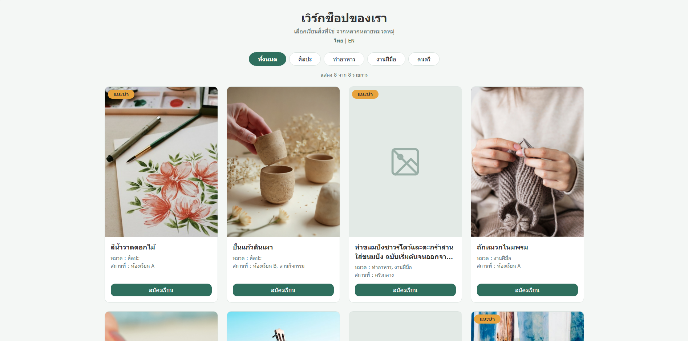
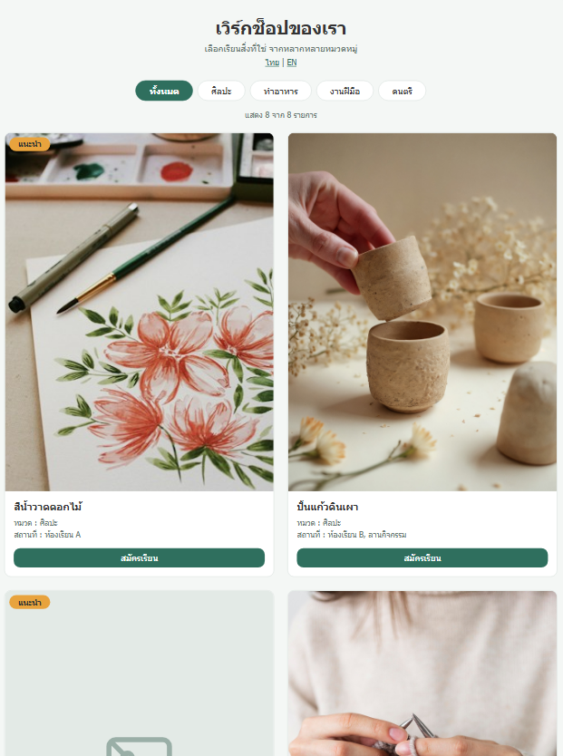
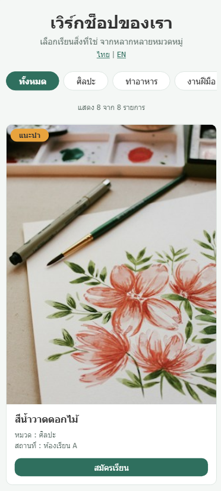

# เวิร์กช็อปของเรา (Workshop Listing)

หน้า `/workshops` แสดงการ์ดเวิร์กช็อป กรองตามหมวดได้ และ responsive 3 ขนาดจอ
ทำด้วย Laravel 11 + Blade + SCSS + JavaScript ล้วน (ไม่มี Bootstrap/Tailwind, ไม่มี Vue/React/Livewire, ไม่ใช้ฐานข้อมูล)

## 1. วิธีรัน

ต้องมี PHP 8.2–8.4 และ Composer (PHP 8.5 รันได้ แต่ Laravel 11 จะแสดงคำเตือน deprecated) (Node.js ใช้เฉพาะตอนจะ compile SCSS ใหม่)

```bash
git clone https://github.com/mmookky/workshop-listing.git
cd workshop-listing
composer install
cp .env.example .env 
php artisan key:generate
php artisan serve
```
เปิด http://127.0.0.1:8000/workshops

```bash
npm install
npm run sass          # compile ครั้งเดียว
npm run sass:watch    # compile ใหม่อัตโนมัติทุกครั้งที่บันทึก
```

## 2. ภาพหน้าจอ

| Desktop | Tablet | Mobile |
|---|---|---|
|  |  |  |

## 3. คำตอบกรณีที่ต้องคิดเอง

**1) หลายหมวด (id 3)**
การ์ดขึ้นในทุก tab ที่ตรงกัน (ทั้ง "ทำอาหาร" และ "งานฝีมือ") เก็บหมวดไว้ใน `data-categories="ทำอาหาร|งานฝีมือ"` คั่นด้วย `|` แล้ว JS `split('|')` และเช็คด้วย `indexOf` เพื่อให้ตรงทั้งคำ ค่าใน `data-*` เป็นชื่อหมวดจากข้อมูลโดยตรง การกรองจึงทำงานเหมือนกันทั้งสองภาษา

**2) ชื่อยาวมาก (id 3)**
ตัดที่ 2 บรรทัดด้วย `line-clamp` และใส่ `title` ไว้ให้เห็นชื่อเต็มตอนเอาเมาส์ชี้ แต่ยังให้ปุ่มอยู่ล่างสุด

**3) ไม่มีรูป (id 3, 7)**
แสดงไอคอนรูปภาพที่มีเส้นขีดฆ่า ใช้ SVG เพราะไม่ต้องมีไฟล์รูปเพิ่ม ไม่เปลืองทรัพยากรในการโหลด จัดการที่ **Blade** ด้วย `@if` เพราะเป็นเรื่องการแสดงผล ไม่ได้แก้ค่า `null` ในข้อมูลหรือ Controller 

**4) หลายสถานที่ (id 6)**
เชื่อมในบรรทัดเดียวด้วย ", " คิดว่า common แล้วอ่านง่าย

**5) tab ที่มีรายการเดียว (ดนตรี)**
การ์ดชิดซ้ายของ grid และกว้างเท่าการ์ดปกติ (1 ใน 4 คอลัมน์) ไม่ยืดเต็มแถว เพราะรูป 3:4 ถ้ายืดเต็มแถวจะใหญ่เกินและผิดสัดส่วน

## 4. สิ่งที่ตัดสินใจเอง (โจทย์ไม่ได้บอก)

- **Laravel 11 และ `--no-security-blocking`:** Composer 2.11 ปฏิเสธติดตั้ง `laravel/framework` 11.x ทุกรุ่นเพราะมี security advisories 
AI แนะนำ 13 แต่ ถ้าประเมินจากโปรเจกต์ไม่ได้มีข้อมูลอะไรที่น่าเป็นห่วง ไม่มีฐานข้อมูล ไม่มีข้อมูลสำคัญ และไม่ได้ deploy  เลยใช้ 11 ตามโจทย์
- **สีเสริม:** นอกจากสีที่โจทย์แนะนำ 4 สี เพิ่มสีสำหรับขอบ พื้นหลัง placeholder และปุ่มตอน hover (อยู่ใน `_variables.scss`)
- **/ page:** ทำปุ่ม link ไป /workshops เพราะจะได้ไม่เสียเวลาในการนั่งพิมพ์ path ทุกครั้ง เลยทำเป็นปุ่มแล้วกด link ง่ายๆ

## 5. ถ้ามีเวลาจะทำอะไรต่อ

- ช่องค้นหาชื่อเวิร์กช็อป
- เรียงลำดับ (เช่น แนะนำก่อน) หรือกรองตามสถานที่

## 6. ที่มาของรูป

รูปอยู่ใน `public/images/workshops/` (ย่อขนาดแล้ว)

| ไฟล์ | เว็บ | ผู้สร้าง / ลิงก์ |
|---|---|---|
| workshop-1.jpg | Unsplash | Victoria Berman — https://unsplash.com/photos/red-petaled-flower-painting-U-ouhtPgHH4 |
| workshop-2.jpg | Magnific (ภาพ AI ฟรี) | ไม่ทราบชื่อผู้สร้าง — https://www.magnific.com/free-ai-image/beautiful-pottery-work_359218353.htm |
| workshop-4.jpg | Magnific (ภาพถ่ายฟรี) | ไม่ทราบชื่อผู้สร้าง — https://www.magnific.com/free-photo/woman-home-knitting-close-up_13447932.htm |
| workshop-5.jpg | Magnific (ภาพถ่ายฟรี) | pressfoto — https://www.magnific.com/free-photo/woman-learning-draw_5400090.htm |
| workshop-6.jpg | Unsplash | CJ — https://unsplash.com/photos/a-wooden-guitar-sitting-on-top-of-a-sandy-beach-0k_QICzdzmw |
| workshop-8.jpg | Unsplash | Zhang Yi — https://unsplash.com/photos/colorful-fabrics-hanging-and-drying-in-sunlight-LlVUOR0eGcY |

## 7. การใช้ AI

ใช้ Claude ในลักษณะของการไปทีละขั้นตอน
- ให้ช่วยแนะนำ php Laravel SCSS การใช้งาน การติดตั้ง
- ร่างโค้ด Blade / SCSS / JavaScript โดยการอธิบายโดยละเอียดของการทำงานแต่ละส่วน
- ให้ช่วยสแกนหาข้อผิดพลาดและตรวจสอบความถูกต้องของ source code
- ให้ช่วยในทุกส่วน แต่เน้นทีละ step เพื่อความละเอียดและการทำความเข้าใจ
